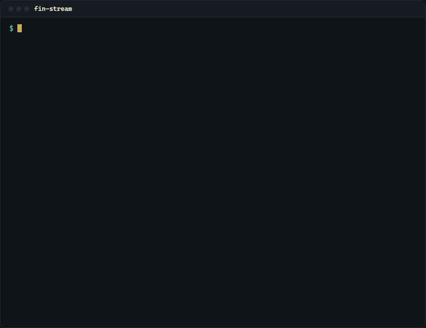
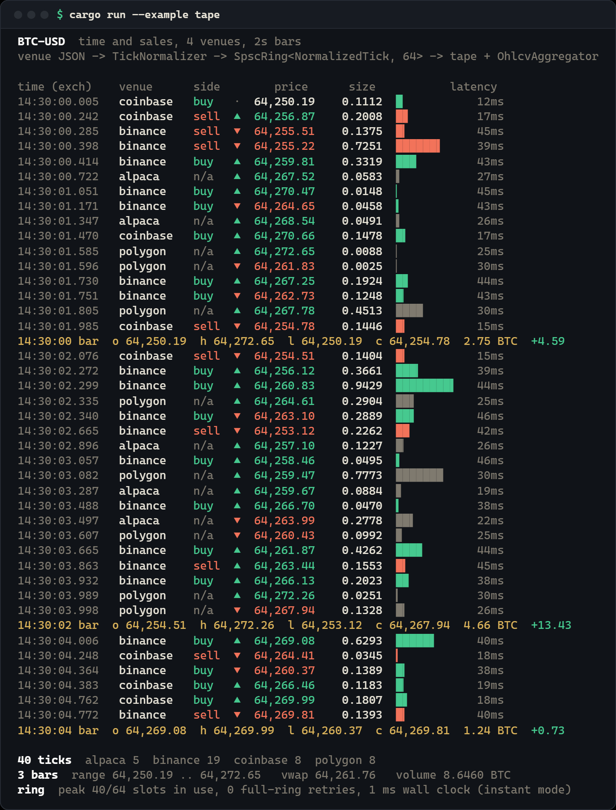
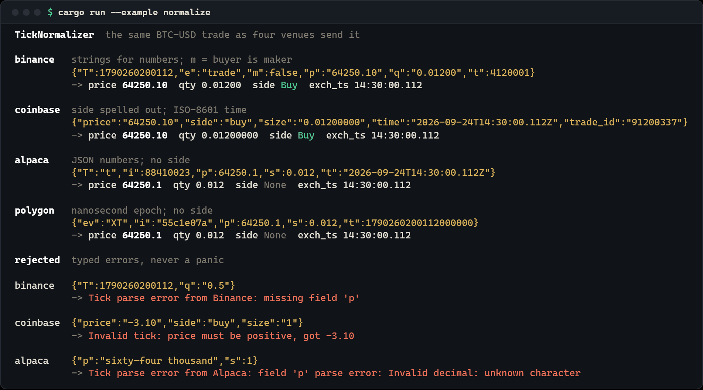
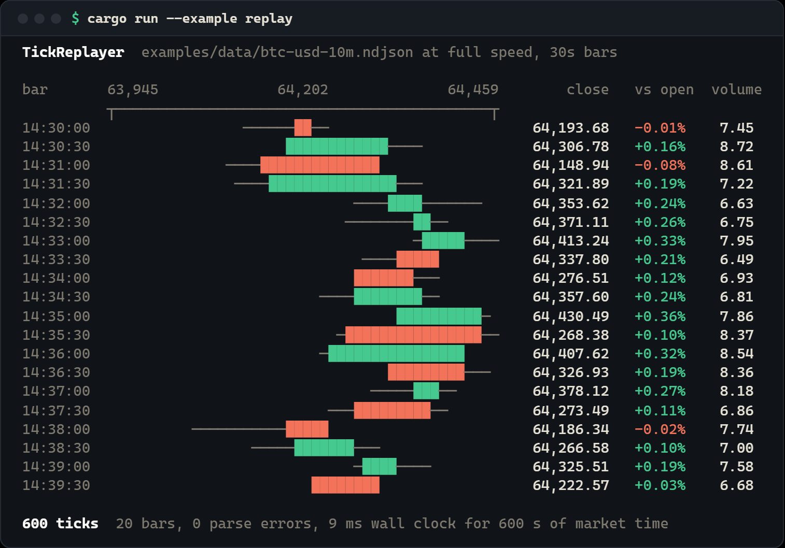

# fin-stream: details

Everything cut from the main [README](../README.md).

<!-- outcome-block -->
**Live trades from Binance, Coinbase, Alpaca and Polygon in one tick format, rolled into OHLCV candles. You write no exchange clients.**

Every exchange has its own message format and reconnect quirks. This handles all four: reconnect backoff, a lock-free ring buffer, rustls TLS (no OpenSSL, no cmake).

If it doesn't do what this README says, [open an issue](https://github.com/Mattbusel/fin-stream/issues) and I'll fix it.
<!-- outcome-block -->

**A Rust library for live trades.** Takes messages from Binance, Coinbase, Alpaca and Polygon. Turns them into one tick format with exact prices. Passes them between threads through a lock-free ring buffer. Rolls them into OHLCV candles.

<p align="center">
  
</p>

## Install

```bash
cargo add fin-stream serde_json
```

It is a library, so nothing to install system-wide. Needs Rust 1.81 or newer (checked in CI).
TLS for `wss://` feeds is rustls with the ring provider: no OpenSSL, no cmake.
`serde_json` is only for building raw payloads with `json!`. Or in `Cargo.toml`:
`fin-stream = "2.12"`. See it first: `git clone https://gitlab.com/mattbusel/fin-stream && cd fin-stream && cargo run --example tape`.

## How it works

`WsManager` keeps the exchange WebSocket open, reconnects with backoff, and hands you each
text frame. Wrap the frame in a `RawTick`. `TickNormalizer` turns any of the four formats into
one `NormalizedTick` with `Decimal` price and size. A feed thread pushes ticks into an `SpscRing`.
Your thread pops them and sends them to bars, features or anything else.
Depth messages go into an `OrderBook` that rejects crossed books and sequence gaps.

<p align="center"></p>

## Why fin-stream

- **Four venues, one tick type.** Binance and Coinbase (crypto), Alpaca and Polygon (US
  stocks). All become the same `NormalizedTick` with exact `Decimal` price and size.
  [`barter-data`](https://crates.io/crates/barter-data) covers more crypto exchanges but no
  stocks. The `barter` feature below hands fin-stream's stock ticks to barter code.
- **Stays connected.** `WsManager` reconnects with backoff, resets its retry budget after
  each good connection, replaces silent half-open connections, and stops when you drop the
  receiver. Tested against a real local WebSocket server, not mocks.
- **Bad input never panics.** The JSON normalizers and the FIX 4.2 parser are
  property-tested with random payloads and random bytes.
- **Measured, including where others win** ([bench/competitors](../bench/competitors/README.md)).
  On one thread, `SpscRing` did about 1.2 billion push/pop operations per second, ahead of
  `rtrb`, `ringbuf` and crossbeam's `ArrayQueue`. Across two threads `rtrb` and `ringbuf`
  were faster (about 146 and 139 million items per second vs 121 million).
- **Counters.** With the `metrics` feature, connections, reconnects, messages, bytes, bars
  and late ticks go to whatever recorder you install (Prometheus, StatsD, OpenTelemetry).

## Feature flags

| feature | default | adds |
|---|---|---|
| `fin-primitives` | yes | `Tick::try_from(&NormalizedTick)` into [fin-primitives](https://crates.io/crates/fin-primitives) (bars, 700+ indicators, order book, risk), and `?` on its errors |
| `metrics` | no | counters through the [`metrics`](https://crates.io/crates/metrics) facade; table in the `telemetry` module docs |
| `grpc` | no | a tonic gRPC server that streams ticks to remote clients (generated code is checked in, no `protoc` needed) |
| `barter` | no | `PublicTrade::try_from(&NormalizedTick)` for [barter-data](https://crates.io/crates/barter-data) strategies |

## Examples

Four programs in [`examples/`](../examples/). No network, no API keys, same trades every run.
In a terminal they stream in real time. Piped, they print at once. `NO_COLOR=1` turns colors off.

| Run this | You get |
|---|---|
| `cargo run --example tape` | four venues' trades normalized on a feed thread, passed through an `SpscRing`, printed as a live time-and-sales tape and rolled into 2-second bars |
| `cargo run --example normalize` | one trade as each venue sends it, the one `NormalizedTick` each becomes, and three typed rejections |
| `cargo run --example feed_health` | `HealthMonitor` watching four feeds: one goes quiet, turns stale, trips its circuit and recovers |
| `cargo run --example replay` | a recorded NDJSON file streamed through the live-feed trait into 30-second bars |

**`tape`** is the recording at the top: four venues, one format, each 2-second bar printed when it closes.

**`feed_health`** (real output, run 2026-09-28, `NO_COLOR=1`):

```text
  binance   ││││││││││││││││││││││││││││││││││││││││││││││││  healthy   96 beats, last  0.0s ago
  coinbase  │││││││││····▒▒█████████││││││││││││││││││││││││  healthy   33 beats, last  0.0s ago
  alpaca    ·││·││·││·││·││·││·││·││·││·││·│···▒▒███████████  open      21 beats, last  8.2s ago
  polygon   ·····│·····│·····│·····│·····│·····│·····│·····│  healthy    8 beats, last  0.0s ago
            0s        5s        10s       15s       20s

  t+ 7.0s  coinbase  Feed 'coinbase' is stale: last tick was 2500ms ago (threshold: 2000ms)
  t+ 8.0s  coinbase  circuit OPEN after 3 stale checks
  t+12.5s  coinbase  heartbeat received, circuit closed
```

(`│` heartbeat, `·` quiet, `▒` stale, `█` circuit open. The header and the last lines are cut for length.)

<details>
<summary><b>tape</b> (full run), <b>normalize</b> and <b>replay</b> output</summary>

<br>

<p align="center"></p>

<p align="center"></p>

<p align="center"></p>

</details>

## Use it in 3 steps

**1. Make a project and add the crate**

```bash
cargo new tick-demo && cd tick-demo
cargo add fin-stream serde_json
```

**2. Put this in `src/main.rs`**

```rust
use fin_stream::tick::{Exchange, RawTick, TickNormalizer};
use serde_json::json;

fn main() -> Result<(), fin_stream::StreamError> {
    let normalizer = TickNormalizer::new();

    // One BTC trade each, in the JSON shape each exchange really sends.
    let trades = [
        (Exchange::Binance, json!({"p": "64251.30", "q": "0.40", "m": true, "t": 7, "T": 1790260201205u64})),
        (Exchange::Coinbase, json!({"price": "64250.10", "size": "0.012", "side": "buy"})),
        (Exchange::Alpaca, json!({"p": 64252.0, "s": 0.05, "i": 99})),
        (Exchange::Polygon, json!({"p": 64249.75, "s": 0.2, "i": "p-1"})),
    ];

    // Four formats in, one tick type out.
    for (venue, payload) in trades {
        let tick = normalizer.normalize(RawTick::new(venue, "BTC-USD", payload))?;
        let side = tick.side.map_or("n/a".to_string(), |s| s.to_string());
        println!("{:<9} {:<5} {:>6} BTC @ {}", tick.exchange.to_string(), side, tick.quantity, tick.price);
    }

    // Bad input is a typed error, not a panic.
    let broken = RawTick::new(Exchange::Binance, "BTC-USD", json!({"q": "1"}));
    println!("no price  -> {}", normalizer.normalize(broken).unwrap_err());
    Ok(())
}
```

**3. Run it**

```bash
cargo run
```

You will see:

```text
Binance   sell    0.40 BTC @ 64251.30
Coinbase  buy    0.012 BTC @ 64250.10
Alpaca    n/a     0.05 BTC @ 64252.0
Polygon   n/a      0.2 BTC @ 64249.75
no price  -> Tick parse error from Binance: missing field 'p'
```

Four exchanges write a trade four ways. You get one `NormalizedTick` with exact decimal
price and size for each. Venues that don't say which side was the aggressor show `n/a`, not
a guess. A bad message is an error you can match on. `cargo test --doc` compiles and runs
this exact program.

## Documentation

| Read this | For |
|---|---|
| [docs.rs/fin-stream](https://docs.rs/fin-stream) | every type and method |
| [docs/EXAMPLES.md](EXAMPLES.md) | short recipes: ring buffer, bars, normalizers, order book, feed health, sessions, Lorentz features |
| [docs/ARCHITECTURE.md](ARCHITECTURE.md) | what every module does, supported exchanges and their wire fields, design rules, benchmark numbers, adding an exchange |
| [docs/REFERENCE.md](REFERENCE.md) | module guides (multi-feed and NBBO aggregation, circuit breakers, feed quality, anomalies, replay, FIX 4.2, gRPC, OFI, VPIN, microstructure, regimes and more), math, API signatures, every `StreamError` |
| [docs/TESTING.md](TESTING.md) | running the tests and benchmarks, current test status |
| [CHANGELOG.md](../CHANGELOG.md) | what changed in each version |
| [Project site](https://fin-stream-rs.vercel.app/) | the same overview as a web page |

The gRPC server is behind the `grpc` feature. Metrics, interop and the rest are in the
feature table above.

> Research and engineering library. It does not place orders, and nothing here is financial advice.

## Contributing

Issues and PRs welcome. Public items need `///` docs (`#![deny(missing_docs)]`).
Code that can fail returns `Result<_, StreamError>`. New behavior needs a test. Run `cargo fmt`,
`cargo clippy` and `cargo test --doc` before a PR. To add an exchange, follow
[Adding a new exchange adapter](ARCHITECTURE.md#adding-a-new-exchange-adapter).

## License and related projects

MIT, see [LICENSE](../LICENSE). Pairs with [fin-primitives](https://gitlab.com/mattbusel/fin-primitives)
(checked price and quantity types, order book, indicators, risk): convert ticks with
`fin_primitives::tick::Tick::try_from(&tick)`. The `lorentz` module comes from
the Special Relativity Financial Modeling work: [Special-Relativity-in-Financial-Modeling](https://gitlab.com/mattbusel/Special-Relativity-in-Financial-Modeling),
[srfm-python](https://gitlab.com/mattbusel/srfm-python), [srfm-paper-impl](https://gitlab.com/mattbusel/srfm-paper-impl) and [srfm-lab](https://gitlab.com/mattbusel/srfm-lab).
